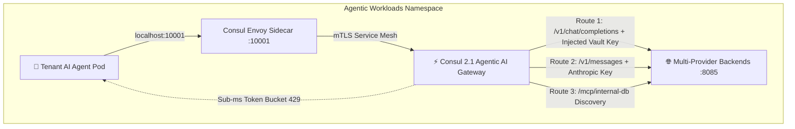

# 🚀 Consul 2.1 Agentic Runtime Fabric — Live Demo Guide

This guide provides a comprehensive walkthrough for demonstrating the **HashiCorp Consul 2.1 Agentic Runtime Fabric** running live on **Red Hat OpenShift (ROSA 4.22)**.

---

## 🌟 Architectural Overview



### Key Architectural Shifts

| Traditional AI Gateway | **Consul 2.1 Agentic Runtime Fabric** |
|---|---|
| **App-level API Keys:** Secrets hardcoded in pods or env vars | **Proxy-layer Secret Injection:** Injected transparently at the mesh proxy |
| **Custom Python Rate Limiting:** High CPU, GIL contention, cold starts | **Sub-millisecond Native Token Bucket:** Enforced in Envoy proxy C++ kernel |
| **Brittle Model Routing:** Hardcoded upstream URLs in client code | **Consul Dynamic ServiceRoute:** Route by header (`x-model-family`, tenant) |
| **Static Tool Endpoints:** Hardcoded MCP tool network configs | **Consul Service Mesh Discovery:** Zero-trust mTLS to any MCP tool backend |

---

## 🧭 Live Demo Steps

### **Step 1: Open the Consul Enterprise UI & Authenticate**

1. **Public Web UI URL:**
   **[https://consul-ui-consul.apps.rosa.cluster2.s5az.p3.openshiftapps.com/ui/](https://consul-ui-consul.apps.rosa.cluster2.s5az.p3.openshiftapps.com/ui/)**
2. Click **Log In** in the top-right corner.
3. Paste the Management ACL Token:
   ```text
   7bcdc765-686c-7a9d-1f4a-e34bff76fe96
   ```
4. **Highlights to Show:**
   * **Services View:** `ai-agentic-gateway`, `agentic-providers`, and `tenant-agent-b` with green health status.
   * **Upstream Mesh Routing:** In `tenant-agent-b`, show the transparent proxy routing upstream to `ai-agentic-gateway:10001`.

---

### **Step 2: Dynamic Credential Injection & Primary Model Routing**

Demonstrate that the tenant AI agent (`tenant-agent-b`) sends standard OpenAI payloads **without needing raw provider API keys**. The Consul Agentic Fabric automatically injects Vault-managed credentials at the proxy layer.

```bash
TENANT_POD=$(oc get pods -n agentic-workloads -l app=tenant-agent-b -o jsonpath='{.items[0].metadata.name}')

oc exec $TENANT_POD -n agentic-workloads -c agent-runtime -- python3 -c '
import urllib.request, json
url = "http://localhost:10001/v1/chat/completions"
payload = {"model": "gpt-4o", "messages": [{"role": "user", "content": "Analyze portfolio risk"}]}
headers = {"Content-Type": "application/json", "x-tenant-id": "tenant-research"}
req = urllib.request.Request(url, data=json.dumps(payload).encode(), headers=headers)
with urllib.request.urlopen(req) as resp:
    print(json.dumps(json.loads(resp.read()), indent=2))
'
```

**Expected Result:**
```json
{
  "id": "chatcmpl-openai-mock",
  "provider": "openai",
  "model": "gpt-4o",
  "choices": [
    {
      "index": 0,
      "message": {
        "role": "assistant",
        "content": "[OpenAI Provider Response via Consul Agentic Mesh] Processed for tenant-research."
      },
      "finish_reason": "stop"
    }
  ],
  "usage": {
    "prompt_tokens": 6,
    "completion_tokens": 15,
    "total_tokens": 21
  },
  "headers_inspected": {
    "x-tenant-id": "tenant-research",
    "has_injected_api_key": true
  }
}
```

---

### **Step 3: Multi-Provider Routing (Anthropic Fallback)**

Show that switching models requires **no DNS or endpoint changes** in the agent code. Calling `/v1/messages` dynamically maps to the Anthropic provider.

```bash
oc exec $TENANT_POD -n agentic-workloads -c agent-runtime -- python3 -c '
import urllib.request, json
url = "http://localhost:10001/v1/messages"
payload = {"model": "claude-3-5-sonnet", "messages": [{"role": "user", "content": "Summarize filings"}]}
headers = {"Content-Type": "application/json", "x-tenant-id": "tenant-research"}
req = urllib.request.Request(url, data=json.dumps(payload).encode(), headers=headers)
with urllib.request.urlopen(req) as resp:
    print(json.dumps(json.loads(resp.read()), indent=2))
'
```

**Expected Result:**
```json
{
  "id": "msg-anthropic-mock",
  "provider": "anthropic",
  "model": "claude-3-5-sonnet",
  "content": [
    {
      "type": "text",
      "text": "[Anthropic Fallback Provider Response] Responded seamlessly for tenant-research."
    }
  ],
  "usage": {
    "input_tokens": 20,
    "output_tokens": 15
  }
}
```

---

### **Step 4: Model Context Protocol (MCP) Tool Discovery**

Show an agent discovering and querying an internal database tool (`/mcp/internal-db`) over the zero-trust mesh:

```bash
oc exec $TENANT_POD -n agentic-workloads -c agent-runtime -- python3 -c '
import urllib.request, json
url = "http://localhost:10001/mcp/internal-db"
payload = {"query": "SELECT * FROM accounts"}
headers = {"Content-Type": "application/json", "x-tenant-id": "tenant-research"}
req = urllib.request.Request(url, data=json.dumps(payload).encode(), headers=headers)
with urllib.request.urlopen(req) as resp:
    print(json.dumps(json.loads(resp.read()), indent=2))
'
```

**Expected Result:**
```json
{
  "mcp_server": "internal-db-service",
  "status": "success",
  "data": [
    {
      "account_id": "ACC-8801",
      "balance": 950000.0,
      "tenant": "tenant-research"
    }
  ]
}
```

---

### **Step 5: Native Token Bucket Rate Limiting (TPM & RPM Protection)**

Show how Consul's native Envoy filter drops burst traffic before it hits the LLM backend or consumes token quota, returning `429 Too Many Requests` directly from the proxy:

```bash
oc exec $TENANT_POD -n agentic-workloads -c agent-runtime -- python3 -c '
import urllib.request, json
url = "http://localhost:10001/v1/chat/completions"
data = json.dumps({"model": "gpt-4o", "messages": [{"role": "user", "content": "Rate limit probe"}]}).encode()
headers = {"Content-Type": "application/json", "x-tenant-id": "tenant-research"}

statuses = []
for i in range(70):
    req = urllib.request.Request(url, data=data, headers=headers)
    try:
        with urllib.request.urlopen(req) as resp:
            statuses.append(resp.status)
    except urllib.error.HTTPError as e:
        statuses.append(e.code)

print(f"Total Requests: {len(statuses)}")
print(f"✅ Allowed (200 OK): {statuses.count(200)}")
print(f"🛡️ Rate-Limited (429 Too Many Requests): {statuses.count(429)}")
'
```

**Expected Result:**
```text
Total Requests: 70
✅ Allowed (200 OK): 50
🛡️ Rate-Limited (429 Too Many Requests): 20
```

---

### **Step 6: Multi-Tenant Token Observability**

Inspect the live token ledger tracking LLM token consumption across tenants:

```bash
oc exec $TENANT_POD -n agentic-workloads -c agent-runtime -- python3 -c '
import urllib.request, json
url = "http://localhost:10001/metrics/tokens"
with urllib.request.urlopen(url) as resp:
    print(json.dumps(json.loads(resp.read()), indent=2))
'
```

---

## 🛠️ Helm Deployment Commands

```bash
# 1. Install Consul Control Plane
cd consul_install/openshift && ./install-consul.sh

# 2. Deploy Stack B (Agentic Fabric)
helm upgrade --install agentic-fabric ./helm/agentic-fabric --namespace agentic-workloads

# 3. Expose Consul UI Route (if not already created)
oc create route passthrough consul-ui --service=consul-ui --port=https -n consul
```
